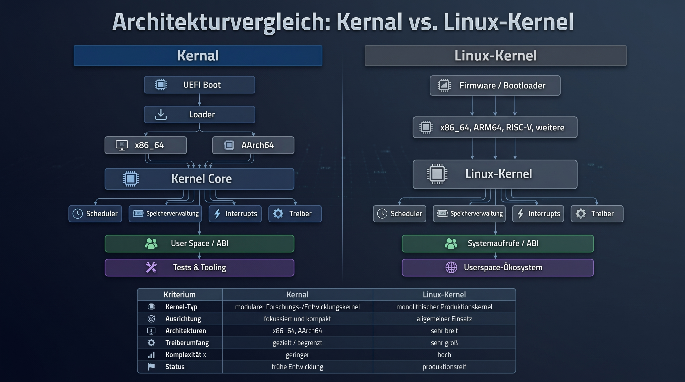

# Qyronex Kernal

[Deutsche Dokumentation](README_DE.md) · [German documentation index](docs/de/README.md) · [Technical dissertation-style monograph](docs/de/DISSERTATION_QYRONEX_KERNAL.md)

**Qyronex Kernal** is an experimental capability-oriented hybrid kernel written primarily in Rust. It was designed and built by **Moritz Wallinger**.

The project explores a small privileged core, explicit capability-based authority, protected userspace execution, and Linux userspace ABI compatibility while deliberately avoiding the assumption that Linux's internal kernel architecture must be reproduced.

> **Development status:** active research and development. Kernal is not production-ready and must not yet be used as a production security boundary.



## Core goals

- Keep privileged and unsafe code as small and auditable as possible.
- Make authority explicit through capabilities instead of relying only on ambient global access.
- Enforce strict memory, execution, ownership, and lifecycle boundaries.
- Provide Linux userspace compatibility through a compatibility layer rather than by copying Linux internals.
- Keep architecture-specific mechanisms separated from architecture-neutral policy.
- Make important runtime behavior reproducible and testable in QEMU.

## Current platform

The primary runtime target is **AArch64 / ARM64**. The tree also contains x86_64 components and architecture-neutral subsystems.

The repository includes protected EL0 execution, AArch64 exception/syscall/context handling, virtual memory, ELF loading, process and thread lifecycle infrastructure, signals, futexes, file-descriptor and VFS work, firmware parsing, secure-storage architecture work, and QEMU-based verification.

Linux compatibility targets the **userspace ABI**. Linux kernel modules are not a compatibility target.

## Build

The workspace currently pins Rust **1.98.0**.

```bash
rustup toolchain install 1.98.0 --profile minimal --component rust-src,rustfmt,clippy,llvm-tools-preview
rustup target add --toolchain 1.98.0 aarch64-unknown-none-softfloat
cargo xtask arm-build
```

## Run in QEMU

```bash
cargo xtask arm-qemu
```

## Verification

```bash
bash tools/arm-first-verify.sh
```

The public verification path covers formatting, workspace tests, strict Clippy checks, the AArch64 build, and the QEMU runtime path.

## Repository structure

```text
.
├── abi/        Linux and native ABI definitions
├── boot/       boot, ELF, mapping, UEFI and handoff support
├── drivers/    device-driver components
├── firmware/   ACPI/FDT and platform parsing
├── kernel/     kernel subsystems and architecture backends
├── tests/      integration and compatibility tests
├── tools/      build, verification and research utilities
├── xtask/      Rust build/QEMU orchestration
└── docs/       technical documentation
```

## Documentation

- [German documentation overview](docs/de/README.md)
- [German dissertation-style technical monograph](docs/de/DISSERTATION_QYRONEX_KERNAL.md)
- [Debian 13 compatibility roadmap](DEBIAN_13_COMPATIBILITY_ROADMAP.md)
- [Secure storage architecture](SECURE_STORAGE_ARCHITECTURE.md)
- [Boot protocol](docs/BOOT_PROTOCOL.md)
- [Memory layout](docs/MEMORY_LAYOUT.md)

## Security principles

Kernal uses fail-closed design rules: unsafe code should remain narrow and documented; writable/executable mappings must not coexist; page zero stays unmapped; user-memory access is explicit; object authority should be capability-mediated; unsupported Linux operations must fail explicitly rather than report fake success.

These are design goals and architecture contracts, not a claim of a completed production security audit.

## Author

Qyronex Kernal was designed and built by **Moritz Wallinger**. See [AUTHORS.md](AUTHORS.md).

## License

Qyronex Kernal is distributed under the **Qyronex Kernal Non-Commercial License 1.0**. Private, educational, academic and other qualifying non-commercial use is permitted under the license terms. **Commercial use is prohibited unless a separate written commercial license has been granted.**

See [LICENSE](LICENSE) for the controlling license text.
